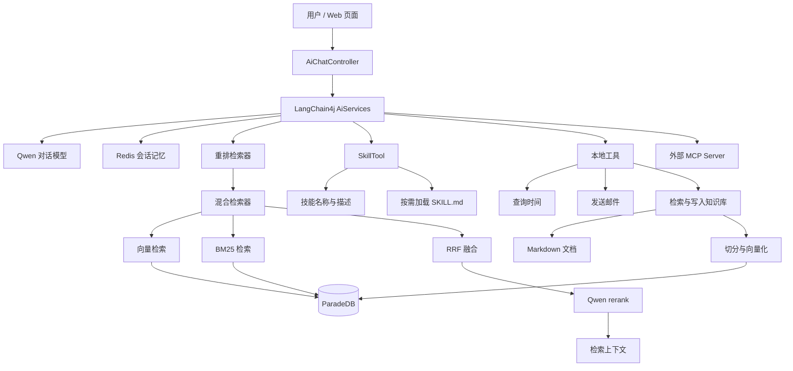

# InfiniteChat-Agent

基于 Java 17、Spring Boot 与 LangChain4j 构建的技术文档 Agent，支持两阶段混合检索 RAG、技能按需加载、运行时知识入库、MCP 工具调用和 Redis 会话记忆。

项目围绕技术文档问答中的三个问题展开：

- 如何结合语义与关键词，提高知识检索质量。
- 如何让知识库在运行期间接收新知识。
- 如何通过评测与监控验证优化效果。

## 核心能力

| 能力 | 实现 |
| --- | --- |
| 两阶段混合检索 | 向量与 BM25 双路召回，RRF 融合后使用 Qwen rerank 重排序 |
| 结构化文档切分 | 按 Markdown 三级标题切分，超长内容递归拆分，片段前拼接来源文件名 |
| Agent Skills | 技能名称和描述常驻提示词，正文通过 `loadSkill` 按需加载 |
| 动态知识入库 | 检索查重、规范化 Q&A、追加 Markdown、向量化入库 |
| 工具调用 | 查询时间、发送邮件、检索及写入知识库 |
| MCP 集成 | 通过 Streamable HTTP 接入外部 MCP Server |
| 会话记忆 | Redis 持久化，按 MemoryId 区分会话，20 条消息窗口及 TTL |
| 流式响应 | 支持流式输出模型回答 |
| 评测与监控 | 独立 RAG 评测接口、模型调用与 Token 指标采集 |

## 技术栈

- **应用框架**：Java 17、Spring Boot 3.5.9
- **Agent 框架**：LangChain4j 1.17.2，Community 模块 1.17.2-beta27
- **模型服务**：Alibaba Qwen，使用 qwen3-max、text-embedding-v4、qwen3-rerank
- **检索存储**：ParadeDB / PostgreSQL、pgvector、pg_search
- **会话存储**：Redis
- **工具扩展**：LangChain4j Tools、MCP
- **部署与观测**：Docker、Spring Boot Actuator、Prometheus、Grafana
- **离线评测**：Ragas

具体模型与检索参数以运行配置为准。

## 系统架构



图中表示各模块之间的关系，实际检索、生成与工具执行由框架编排。

## 检索设计

### 文档切分

知识文档以 Markdown Q&A 组织：

```text
### Q. 问题

A：答案
```

`MarkdownHeadingSplitter` 按三级标题切分，尽量让一条 Q&A 保持在同一个片段中。

- 块长度超过 1500 字符时，使用递归切分兜底。
- 递归切分配置为 1000 字符，重叠 100 字符。
- 切分后在正文前拼接来源文件名，并保留来源元数据。

因此，常规 Q&A 可以完整保留；超长 Q&A 仍可能拆成多个片段。

### 双路召回与融合

向量检索负责语义匹配，BM25 负责关键词与技术实体的字面匹配，两路查询使用同一张存储表。

默认流程：

```text
用户问题
  ├── 向量召回 Top-20
  └── BM25 召回 Top-20
           ↓
     文本去重与 RRF 融合
           ↓
       保留 Top-20
           ↓
      Qwen rerank
           ↓
     最终返回最多 Top-5
```

RRF 使用排名融合，避免直接比较向量相似度与 BM25 分数：

```text
score(d) = Σ 1 / (60 + rank_i(d))
```

当前两路检索依次执行。

### 重排序与降级

`RerankingContentRetriever` 以装饰器方式包装混合检索器，默认相关性阈值为 `0.2`。

当前实现包含以下兜底行为：

- 没有候选时返回空结果。
- 只有一个候选时直接返回，跳过重排序。
- 全部候选低于阈值时，仍返回分数最高的若干条。
- 重排序调用失败时，降级为混合检索的前 Top-K 条。

阈值并非严格拒答开关，最终是否回答还取决于模型对资料是否充分的判断。

## Agent Skills 与动态知识入库

项目内置 `kb-curator` 技能，将知识入库操作规程从常驻提示词中拆分出来。

### 渐进式披露

- **L1：技能目录**。启动时扫描 `skills/*/SKILL.md`，提取名称和描述，加入系统提示词。
- **L2：技能正文**。模型通过 `loadSkill` 获取完整操作说明。

技能正文在启动时读入内存，按需加载指按需进入模型上下文。

### 入库流程

```text
用户表达保存知识的意图
        ↓
加载 kb-curator
        ↓
searchKnowledge 检索已有知识
        ↓
判断重复、冲突或新增
        ↓
整理为自包含 Q&A
        ↓
addKnowledgeToRag
        ├── 追加 Markdown
        └── 向量化并写入数据库
```

`searchKnowledge` 与普通问答使用相同的混合检索及重排序链路。

当前查重步骤由技能说明引导模型执行，写入工具没有强制前置查重。文档与向量库依次写入，不具备跨存储原子事务；向量化失败时会向调用方反馈部分失败。

## 会话记忆

通过 `MemoryId` 为会话分配独立的 Redis 记忆记录。

- Redis 支持跨应用实例共享会话记录。
- 每个会话使用 20 条消息的滑动窗口。
- TTL 控制记忆保留时间。

该机制提供有限窗口内的持久化对话记忆。MemoryId 区分会话，并不替代用户身份认证和访问控制。

## 评测结果

以下结果来自项目作者提供的离线实验记录：知识库规模为 746 条 Q&A，评测集共 181 题。

| 题型 | 数量 |
| --- | ---: |
| 单跳 | 117 |
| 多跳 | 47 |
| 负样本 | 15 |
| 部分可答 | 2 |

基线为“段落切分 + 单路向量检索”，优化方案叠加标题切分、混合检索与 rerank。

| 指标 | 基线 | 优化后 |
| --- | ---: | ---: |
| Hit@1 | 0.47 | 0.69 |
| Hit@5 | 0.60 | 0.80 |
| 上下文精确率 | 0.83 | 0.92 |
| 上下文召回率 | 0.85 | 0.91 |
| 忠实度 | 0.94 | 0.95 |
| 答案相关性 | 0.76 | 0.79 |
| 负样本拒答准确率 | 15/15 | 15/15 |

正负样本分开统计，避免将负样本拒答话术与正样本回答直接混合评价。

结果说明：

- 上表体现组合优化收益，不代表各模块的独立贡献。
- 负样本结果仅覆盖本评测集的 15 道题。
- 当前仓库提供 Java 评测入口；完整评测集、Python/Ragas 脚本及原始报告尚未纳入版本管理，暂不构成完整的可复现实验包。

### 评测入口

`POST /eval/rag` 仅在 `dev`、`test` 环境启用。

请求：

```json
{
  "question": "项目如何融合向量检索和 BM25 检索结果？"
}
```

响应包含：

```json
{
  "question": "...",
  "answer": "...",
  "contexts": ["..."]
}
```

该接口复用线上检索器，再单独调用模型生成答案，用于评估 RAG 问答链路；不覆盖完整 Agent 的会话、技能和工具执行流程。

## 快速开始

### 1. 准备环境

- JDK 17
- PostgreSQL / ParadeDB，安装兼容的 `pgvector` 与 `pg_search` 扩展
- Redis
- 可用的 Qwen 模型服务凭证
- 可用的外部 MCP Server 配置
- 如需发送邮件，准备 SMTP 配置

数据库、Redis 和 MCP 等外部依赖需要自行准备；当前仓库未提供完整的一键部署编排。

### 2. 获取代码

```bash
git clone https://github.com/toyyy0627/InfiniteChat-Agent.git
cd InfiniteChat-Agent
```

### 3. 创建本地配置

将：

```text
src/main/resources/application-dev.example.yml
```

复制为：

```text
src/main/resources/application-dev.yml
```

根据自己的环境修改数据库地址、端口、用户名、Redis 配置及知识文档路径。保留代码使用的配置层级和字段名称。

真实开发、生产配置不提交到仓库。

### 4. 设置环境变量

根据配置文件中实际使用的占位符设置环境变量，例如：

| 变量 | 用途              |
| --- |-----------------|
| `DASHSCOPE_API_KEY` | Qwen 模型服务密钥     |
| `MCP_API_KEY` | 外部联网搜索 MCP 服务密钥 |
| `DB_PASSWORD` | 数据库密码           |
| `REDIS_PASSWORD` | Redis 密码        |
| `MAIL_USERNAME` | 发件邮箱            |
| `MAIL_PASSWORD` | SMTP 授权码        |
| `RAG_DOCS_PATH` | 知识文档所在目录        |

如果使用其他占位符，也需要设置对应变量。IDEA 可在 Run Configuration 的 Environment variables 中配置。

知识文档路径应指向可读写的外部目录。可以将仓库中的 `src/main/resources/docs` 内容复制到该目录，作为初始知识源。

### 5. 启动项目

Windows：

```powershell
.\mvnw.cmd spring-boot:run
```

Linux / macOS：

```bash
./mvnw spring-boot:run
```

也可以通过 IDEA 启动 `InfiniteChatAgentApplication`。

按实际配置的服务端口和上下文路径访问 `index.html`。

注意：当前启动流程会尝试加载并入库知识目录中的文档。连接已有数据库前，应确认重复启动的入库行为，避免重复数据及不必要的模型调用成本。

### 6. 打包运行

Windows：

```powershell
.\mvnw.cmd clean package -DskipTests
```

Linux / macOS：

```bash
./mvnw clean package -DskipTests
```

生产环境运行示例：

```bash
java -jar target/InfiniteChat-Agent-0.0.1-SNAPSHOT.jar \
  --spring.profiles.active=prod \
  --spring.config.additional-location=file:/path/to/config/
```

在外部配置目录中准备 `application-prod.yml`，并提供所需环境变量。

上述打包命令跳过测试，仅用于构建产物，不代表测试通过。仓库提供 Dockerfile，容器运行时也需要注入配置、连接外部依赖并挂载知识目录。

## 可观测性

通过模型监听器、Micrometer 和 Actuator 采集模型调用及 Token 使用指标，并接入 Prometheus / Grafana。

评测请求使用固定的用户与会话标签，便于与普通流量区分。

当前仓库包含 Java 指标采集实现；Prometheus 配置与 Grafana Dashboard 尚未纳入版本管理。

## 项目结构

```text
src/main/java/com/myproject/infinitechatagent/
├── ai/                  # AiServices 构建与对话接口
├── config/              # 模型、检索、MCP、Redis 配置
├── controller/          # 对话入口
├── guardrail/           # 输入检查
├── job/                 # 启动文档加载与 BM25 索引初始化
├── monitor/             # 模型调用指标与监控上下文
├── rag/
│   ├── retriever/       # BM25、RRF 混合检索、重排序
│   └── splitter/        # Markdown 标题切分
├── ragas/               # RAG 评测接口
├── skill/               # 技能发现与按需加载
└── tool/                # 时间、邮件及知识库工具

src/main/resources/
├── application.yml
├── application-dev.example.yml
├── docs/                # 初始知识文档
├── skills/kb-curator/   # 知识入库技能
├── static/              # Web 页面与静态资源
└── system-prompt/       # 系统提示词
```